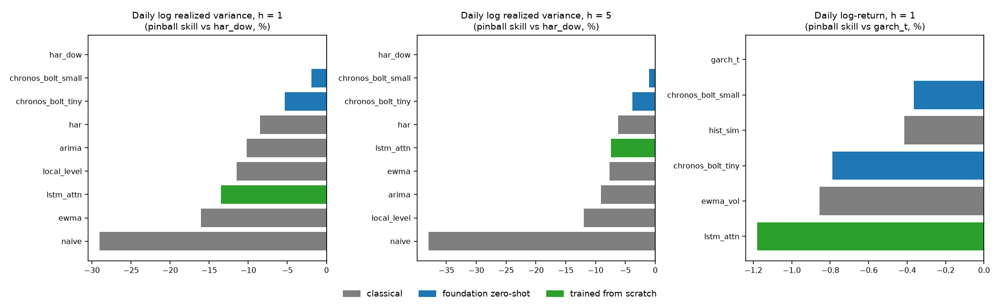

# Do time-series foundation models beat classical forecasts on crypto volatility?

A small, leakage-tested benchmark of **Chronos-Bolt** (zero-shot, and a LoRA attempt) against HAR, ARIMA, a Kalman
local-level model, GARCH and an attention LSTM, on 12 liquid crypto-assets (Binance, 2021-01-02 to 2026-11-23).

## Findings

1. **The baseline decides the conclusion.** Against a plain HAR, Chronos-Bolt small looks like a clear win at one day
   (6.1% lower pinball loss, 12/12 assets). Against a HAR that also knows the *day of the week*, it **loses** by 1.9%
   (Diebold-Mariano p = 0.013, better on 0/12 assets). At five days the gap (1.0%) is not significant (p = 0.16).
2. **Zero-shot is still strong.** With no training on this data, it beats ARIMA, the Kalman local-level model, EWMA and an
   LSTM trained from scratch on volatility, at both horizons.
3. **Returns: nothing beats GARCH(1,1)-t.** Chronos-Bolt small is 0.4% worse, not significantly (p = 0.08).
4. **Its 80% intervals are too narrow** at one day (75.8% coverage on volatility, 77.1% on returns).
5. **LoRA did not help** on volatility: for four learning rates the 2024 validation loss never went below zero-shot, so
   the fine-tuned model was rejected before the test period and has no test score.

| learning rate | best validation loss after training | after 200 steps |
|---:|---:|---:|
| zero-shot | 0.24424 | - |
| 1e-5 | 0.24425 (+0.01%) | 0.24475 (+0.21%) |
| 3e-5 | 0.24429 (+0.02%) | 0.24700 (+1.13%) |
| 1e-4 | 0.24448 (+0.10%) | 0.25211 (+3.22%) |
| 3e-4 | 0.24563 (+0.57%) | 0.27152 (+11.17%) |

The loop does learn (`scripts/check_lora_learns.py`: loss 0.24 to 0.05 on a fixed batch), so this is over-fitting.

## Protocol

- **Targets.** Log realized variance (24 hourly returns) 1 and 5 days ahead; daily log-return 1 day ahead.
- **Split by target date.** Training < 2024, model selection on 2024, test from 2025-01-01 (692 days x 12 assets). Chronos-Bolt
  was released in late 2024, which limits (but does not exclude) pre-training contamination.
- **Same 9 quantiles for everyone**, scored by average pinball loss; Diebold-Mariano tests with Newey-West variance on
  losses averaged across assets. Classical models are re-estimated every 21 days on an expanding window.
- **Look-ahead tests.** `tests/` replaces everything after a date by garbage and checks that no earlier forecast of the
  classical models moves; a deliberately leaky model is included and must be caught. Context windows and splits are tested too.

## Results on the test period

`skill` is relative to the reference model (positive = better). `sec` is the wall-clock time of each run; it is not a fair speed
comparison (classical models are refitted over the whole history).

### Daily log realized variance, horizon 1 day  (n = 8304 forecasts)

| model | family | pinball | skill vs har_dow | DM p | cov80 | calib | MAE(median) | sec |
|---|---|---:|---:|---:|---:|---:|---:|---:|
| har_dow | classical | 0.2270 | ref |  | 0.801 | 0.029 | 0.582 | 0 |
| chronos_bolt_small | foundation zero-shot | 0.2314 | -1.9% | 0.013 | 0.758 | 0.023 | 0.592 | 79 |
| chronos_bolt_tiny | foundation zero-shot | 0.2392 | -5.4% | 0.000 | 0.760 | 0.022 | 0.612 | 16 |
| har | classical | 0.2463 | -8.5% | 0.000 | 0.804 | 0.016 | 0.629 | 0 |
| arima | classical | 0.2502 | -10.2% | 0.000 | 0.806 | 0.026 | 0.641 | 248 |
| local_level | classical | 0.2531 | -11.5% | 0.000 | 0.807 | 0.006 | 0.648 | 48 |
| lstm_attn | trained from scratch | 0.2577 | -13.5% | 0.000 | 0.790 | 0.009 | 0.652 | 0 |
| ewma | classical | 0.2635 | -16.0% | 0.000 | 0.808 | 0.012 | 0.672 | 0 |
| naive | classical | 0.2929 | -29.0% | 0.000 | 0.793 | 0.004 | 0.750 | 0 |

### Daily log realized variance, horizon 5 days  (n = 8304 forecasts)

| model | family | pinball | skill vs har_dow | DM p | cov80 | calib | MAE(median) | sec |
|---|---|---:|---:|---:|---:|---:|---:|---:|
| har_dow | classical | 0.2581 | ref |  | 0.812 | 0.047 | 0.663 | 0 |
| chronos_bolt_small | foundation zero-shot | 0.2607 | -1.0% | 0.158 | 0.791 | 0.021 | 0.666 | 79 |
| chronos_bolt_tiny | foundation zero-shot | 0.2680 | -3.8% | 0.000 | 0.794 | 0.016 | 0.685 | 16 |
| har | classical | 0.2741 | -6.2% | 0.000 | 0.808 | 0.037 | 0.704 | 0 |
| lstm_attn | trained from scratch | 0.2773 | -7.4% | 0.000 | 0.791 | 0.007 | 0.702 | 0 |
| ewma | classical | 0.2780 | -7.7% | 0.000 | 0.808 | 0.015 | 0.710 | 0 |
| arima | classical | 0.2816 | -9.1% | 0.000 | 0.808 | 0.059 | 0.726 | 248 |
| local_level | classical | 0.2890 | -12.0% | 0.000 | 0.811 | 0.010 | 0.742 | 48 |
| naive | classical | 0.3562 | -38.0% | 0.000 | 0.812 | 0.007 | 0.914 | 0 |

### Daily log-return, horizon 1 day  (n = 8304 forecasts)

| model | family | pinball x1000 | skill vs garch_t | DM p | cov80 | calib | R2_oos(median) | sec |
|---|---|---:|---:|---:|---:|---:|---:|---:|
| garch_t | classical | 10.3940 | ref |  | 0.820 | 0.017 | -0.01% | 51 |
| chronos_bolt_small | foundation zero-shot | 10.4320 | -0.4% | 0.082 | 0.771 | 0.011 | -0.75% | 347 |
| hist_sim | classical | 10.4371 | -0.4% | 0.050 | 0.815 | 0.010 | -0.45% | 0 |
| chronos_bolt_tiny | foundation zero-shot | 10.4760 | -0.8% | 0.014 | 0.753 | 0.019 | -1.27% | 17 |
| ewma_vol | classical | 10.4829 | -0.9% | 0.000 | 0.836 | 0.033 | +0.00% | 0 |
| lstm_attn | trained from scratch | 10.5166 | -1.2% | 0.005 | 0.779 | 0.006 | -1.46% | 0 |



## Limitations

- **The day-of-week HAR was added after I saw the first test scores**, because the gain over HAR looked too good. It works
  against the foundation model, but it is a post-hoc choice. I did not give Chronos any calendar information either.
- One family of foundation models, two small sizes (CPU only): no TimesFM, Moirai, Chronos-2 or larger Bolt.
- LoRA: one configuration (r = 8, q/v), volatility only; 40% of its training contexts are padded because the training period
  is short, while validation contexts are complete. This says nothing about LoRA in general.
- The universe is made of assets that are liquid today (survivorship bias) and highly correlated with each other.
- Optimiser convergence of ARIMA / GARCH refits was not audited. LSTM scores are for seed 0 (seeds 1-2 differ by < 0.5%).
- Forecast accuracy only: no trading rule, no economic value is claimed.

## Reproduce

```bash
python3.12 -m venv .venv && .venv/bin/pip install -r requirements.lock.txt   # pinned for Intel macOS (torch 2.2.2)
.venv/bin/python scripts/fetch_data.py            # public Binance klines, no API key
.venv/bin/python scripts/download_models.py       # 226 MB, pinned revisions
.venv/bin/python -m pytest tests
.venv/bin/python scripts/run_classical.py && .venv/bin/python scripts/run_lstm.py
for s in tiny small; do for t in logrv ret; do .venv/bin/python scripts/run_chronos.py $s $t; done; done
for lr in 1e-5 3e-5 1e-4 3e-4; do .venv/bin/python scripts/finetune_lora.py small logrv 200 $lr; done
.venv/bin/python scripts/report.py && .venv/bin/python scripts/robustness.py
```
